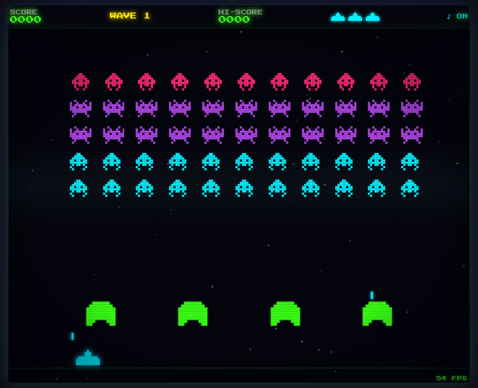

# Space Invaders

Neon arcade Space Invaders on the [aio](https://github.com/riagentic/aio)
framework — desktop (Electron) or browser.



## Download

Grab the build for your system from
[Releases](https://github.com/riagentic/space-invaders/releases/latest). The
builds are not code-signed:

- **Linux** — `space-invaders-*.AppImage`: `chmod +x`, then run it
- **Windows** — `space-invaders-*-win-x64.exe` (or the `.zip`); on the
  SmartScreen prompt choose *More info → Run anyway*
- **macOS** (Apple Silicon) — open the `.dmg`, drag the app to Applications,
  then right-click it → *Open* the first time

## Play from source

Needs [Deno](https://deno.com) and aio's `am` CLI. After cloning, run `am fix`
once — it links the aio framework (`dep/`, gitignored) and installs Electron.

```sh
deno task dev           # Electron window
deno task dev:browser   # browser tab
```

| Key             | Action                    |
| --------------- | ------------------------- |
| `← →` / `A D`   | move                      |
| `Space` / `↑`   | fire                      |
| `P`             | pause                     |
| `M`             | music on/off              |
| `F11`           | fullscreen on/off         |
| `Esc`           | back to menu              |
| `R`             | replay last game (game over) |

## Features

- Classic rules, tuned: grid speeds up as it thins, the last ones sprint,
  capped enemy fire (nearest shooter aims), shoot a bomb for 5, waves start
  lower, wave bonus 100 × wave, bonus cannon at 1500
- Power-ups — 1 kill in 10 drops a capsule: **R**apid fire, **T**riple shot,
  **S**hield (one hit), **L**ife; lost on death
- Pauses itself when the window loses focus
- 4 chiptune themes, sequenced live like MIDI (melody, arpeggio, bass, drums):
  **menu** 112 BPM · each wave starts **slow** 96 BPM → **normal** dance groove
  124 BPM (≤ 36 aliens) → **fast** 150 BPM (last 8); a change fades the old
  song out, then the new one in
- Exact replay: seed + input tape re-simulated (deterministic engine)
- Pixel-art everything (sprites, HUD, lives, pixel font) under smooth modern
  effects: additive glow sparks, shockwaves, bloom, flash, screen shake
- Arcade cabinet: neon themed window frame, CRT scanlines, roll band, vignette
- Fixed 60 Hz simulation on any monitor; no network (fonts bundled, strict CSP)
- Persisted top-5 leaderboard, 4-char names

## Difficulty

One table, `WAVES` in `src/features/game/constants.ts`, holds every knob per
wave. The curve is measured, not guessed: a bot with human-like limits (decides
every 0.1 s, sees bombs 150 px out, aims ahead of its target) plays each wave
from a fresh 3-life cannon. The last alien bolts at 3× the wave's top speed.

| wave | promise              | bot clears |
| ---- | -------------------- | ---------- |
| 1    | doable               | ~90%       |
| 2    | difficult            | ~60%       |
| 3    | extreme, yet doable  | ~25%       |
| 4    | the best only        | ~6%        |
| 5+   | one in a million     | 0 / 400    |

`deno task difficulty` prints the table; `tests/difficulty.test.ts` keeps it.

## Music

Songs are note data in `src/renderer/songs.ts` (tracker style: 8th-note
melodies, chords per bar, 16-step bass and drum patterns), played by a Web
Audio lookahead sequencer — no audio files.

## Develop

```sh
deno task check && deno task lint && deno task test
deno task e2e           # boots a sandboxed instance, drives it with am
deno task build --targets=electron   # desktop package for this OS → dist/
```

Layout: `src/features/game` (pure simulation) · `src/features/scores`
(persisted cell) · `src/renderer` (canvas, effects, audio) · `src/App.tsx` (UI).
Icon: `assets/icon.svg` → `src/icon.png` (aio reads PNG only):
`inkscape assets/icon.svg --export-filename=src/icon.png -w 512 -h 512`.

## License

[MIT](LICENSE). The bundled Press Start 2P font is SIL OFL 1.1
(`src/fonts/OFL-PressStart2P.txt`).
